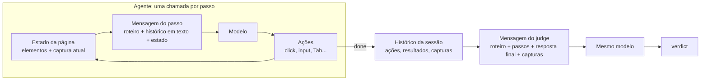

O CUA do harness é um agente do browser-use. O `pyproject.toml` pede
`browser-use>=0.13.8`, e o `uv.lock` fixa a versão 0.13.10. Registro aqui como essa
versão organiza as duas chamadas ao modelo que aparecem em toda sessão: a do agente, que
usa a aplicação e devolve a avaliação, e a do judge, que confere o trabalho do agente.
Conferi tudo no código instalado.

<!-- truncate -->

## O agente

O agente trabalha em passos. Em cada passo, o browser-use lê o estado da página, monta
uma mensagem e chama o modelo, que responde com até cinco ações. As ações rodam no
navegador e o ciclo recomeça, até o agente chamar `done` ou chegar ao limite de passos.

O modelo não recebe a conversa acumulada. A cada passo, o `MessageManager` monta duas
mensagens novas: o prompt de sistema e uma mensagem de estado que junta

- o roteiro da tarefa;
- o histórico dos passos anteriores, em texto: a avaliação do passo anterior, a memória,
  o próximo objetivo e o resultado das ações;
- a URL, as abas e os elementos interativos da página, numerados;
- a captura de tela do momento.

Só a captura atual vai junto. As anteriores ficam no histórico da sessão, mas o agente
não as vê de novo. Como a mensagem de estado é reenviada inteira a cada passo, quase todo
o custo de uma sessão vem dos tokens de entrada.

No harness (`demos/harness/models/avaliacao.py`), o agente roda com:

| Configuração | Efeito |
|---|---|
| `ChatOpenRouter`, `max_tokens` 16.000, `max_retries=0` | modelo via OpenRouter, sem nova tentativa quando a API falha |
| `use_thinking=False` | prompt de sistema sem o campo `thinking`, que aciona o filtro anti-destilação da Anthropic |
| `use_vision` (padrão `True`) | captura de tela em todo passo |
| `exclude_actions=SEM_ACOES_CUA` | sem busca na web, arquivos, extração de conteúdo nem JavaScript: o agente só usa a página pela interface |
| `max_failures=1`, `final_response_after_failure=False` | a sessão para no primeiro erro, sem resposta final forçada |
| `output_model_schema=VeredictoCriterio` | a resposta final é `passou` e `evidencia` |
| `max_steps` | 80 (`MAX_PASSOS_CUA`) |

O `passou` é o agente dizendo que concluiu a tarefa. Não é uma conferência externa.

## O judge

Quando o agente chama `done`, o browser-use faz mais uma chamada ao modelo, o judge
(`_judge_trace`, em `browser_use/agent/service.py`). Ele não abre o navegador. A mensagem
dele é montada do zero por `construct_judge_messages` (`browser_use/agent/judge.py`) e
traz

- o prompt de sistema do judge;
- o roteiro da tarefa;
- as ações e os resultados de cada passo;
- a resposta final do agente;
- capturas de tela da sessão.

A resposta é um `JudgementResult`: `verdict` (verdadeiro ou falso), `reasoning`,
`failure_reason`, `impossible_task` e `reached_captcha`. O browser-use anexa esse parecer
ao último resultado, mas não muda o que o agente declarou: o próprio código diz que o
veredito do judge não substitui o `success` do agente.

## Contextos separados, mesmo modelo

O agente e o judge não compartilham contexto. O agente vê uma mensagem remontada a cada
passo, com só a captura do momento. O judge vê, de uma vez, o registro do que o agente
fez e as capturas, mas não a conversa do agente.

O modelo, porém, é o mesmo. O `Agent` aceita um `judge_llm` próprio, e o harness não
passa nenhum. Sem ele, o browser-use usa o mesmo cliente do agente
(`service.py:255`). O judge é, portanto, o mesmo modelo relendo o rastro do próprio
trabalho: serve para achar passos pulados e evidências que as capturas não mostram, mas
não é um avaliador independente.
