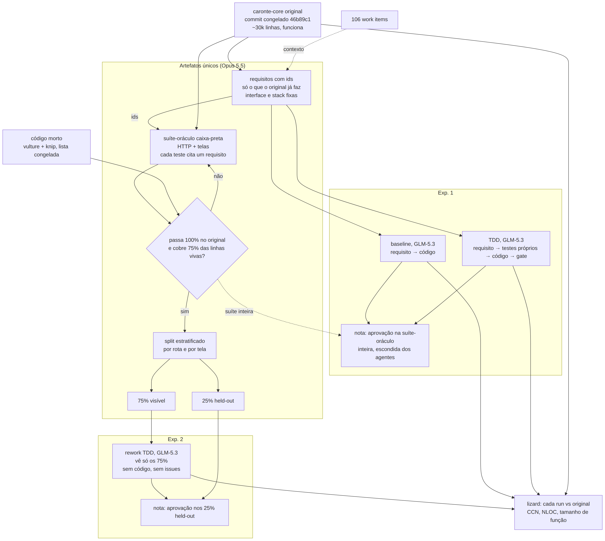

Na conversa com os orientadores, encerramos o experimento dos formulários como
inconclusivo e escolhemos um cenário novo: reconstruir o
[caronte-core](https://gitlab.com/ccsl-usp/poscomp-ime/caronte/caronte-core) com o harness.

<!-- truncate -->

## Onde parou o experimento dos formulários

A vencedora de tudo é a `glm/run38/tdd`, campeã do [torneio TDD](/blog/finalistas-nielsen-tdd),
pelo design mais receptivo e modular. Ela substitui a `deepseek/run44/baseline`, que o
[veredito anterior](/blog/veredito) apontava. As notas das duas estão na
[comparação Nielsen](/blog/nielsen-baseline-vs-tdd).

Mesmo com uma vencedora, o experimento não responde à pergunta do TCC, por três motivos:

1. O formulário é fácil demais para uma LLM. Das 153 runs elegíveis, 94 passam nos doze
   critérios do Cypress e 81 também nos dez extras, com runs dos dois grupos.
2. Quase não há critério sem viés para desempatar. O custo de gerar favorece o baseline, o
   torneio depende do meu gosto, e o CUA muda de nota entre sessões da mesma página
   ([observações sobre o CUA](/blog/observacoes-cua)).
3. Nem as heurísticas de Nielsen separam as finalistas: as notas ficam tão próximas que
   não dá para chamar a diferença de desempate.

## O caronte

O caronte-core é o monorepo do sistema de inscrições em editais da pós-graduação do IME. O
`forms` (Flask) cuida dos formulários de candidatura e das cartas de recomendação, e o
prejanus, com o `prejanus-back` (FastAPI) e o `prejanus-front` (Next), serve para avaliar os
candidatos. São cerca de 30 mil linhas, com Postgres, ClamAV e e-mail, e poucos testes. O
código é aberto, sob AGPL-3.0, e o commit congelado é o
[`46b89c1`](https://gitlab.com/ccsl-usp/poscomp-ime/caronte/caronte-core/-/commit/46b89c1d5519aeae40c088ee94262e9b739a7d48),
de 14/10/2026, copiado sem histórico para `caronte-core/` no repositório do TCC.

Ele é a codebase inicial dos experimentos e funciona, e isso é o que importa: prova que
os requisitos podem ser atendidos, mesmo que não da forma mais otimizada. Juntei os 106 work
items do grupo no GitLab, 58 fechados e 48 abertos, entre o core e os repositórios que
originaram o monorepo.

## Os dois experimentos

**Requisitos.** Saem primeiro, escritos a partir do código, com as issues como contexto.
Só vira requisito o que o original já faz: issue aberta de funcionalidade não implementada
fica fora, porque o original reprovaria nela. Cada requisito tem um id e fixa a interface e a
stack do original: rotas, payloads, telas, rótulos e o comando de subida, em Flask,
FastAPI, Next e Postgres. O login entra pelo atalho de desenvolvimento que o original já tem,
`APP_ENV=local` com `DEV_USER_ID`. Postgres, Redis, smtp4dev, ClamAV e nginx vêm do compose
do original e são os mesmos para todos.

**Suíte-oráculo.** É caixa-preta: testa só a interface externa (HTTP e telas) do caronte no
commit congelado, e cada teste cita o id do requisito que verifica. A suíte só vale se
passar 100% no original. Ela para de crescer quando toda rota e toda tela têm pelo menos um
teste e a cobertura chega a 75% das linhas vivas de cada subsistema (`forms`,
`prejanus-back` e `prejanus-front`). As linhas mortas saem do vulture e do knip, rodados
uma vez no commit congelado, e a lista fica congelada. Requisitos e suíte são congelados
juntos, e uma checagem garante que nenhum teste fica sem requisito. Depois a suíte é
dividida, estratificada por rota e por tela, em 75% visíveis e 25% de held-out.

**Experimento 1: requisitos → código.** Baseline e TDD reconstroem o sistema do zero a
partir dos requisitos. A nota é a aprovação na suíte-oráculo inteira, que nenhum agente vê.

**Experimento 2: rework.** Só o grupo TDD. O agente recebe os 75% visíveis da suíte, sem o
código e sem as issues, e reescreve a plataforma na mesma stack. A nota é a aprovação nos
25% de held-out. Usar a suíte que o agente recebeu como nota seria circular, porque toda
run que termina passaria nela.

O lizard compara as três runs com o original em complexidade ciclomática, NLOC e tamanho de
função, deixando de fora as mesmas linhas mortas. No experimento 1 é medida secundária: a
nota continua sendo a suíte-oráculo.

Há duas suítes no experimento 1, como nos formulários. A suíte-oráculo é a régua, igual
para os dois grupos. Os testes que o grupo TDD escreve durante a run são parte do
tratamento, e o baseline não tem.

## Como as runs rodam

As três runs usam o GLM-5.3 via OpenRouter, o modelo que ficou com as três primeiras
posições do torneio TDD. O mesmo modelo em todas as etapas e nos dois grupos evita que o
modelo se confunda com o grupo, como aconteceu na comparação entre a run44 e a run38.

O harness continua dono do laço: escopo de cada etapa, orçamento, gate e `RUN.log`. Muda o
agente dentro dele. Hoje, a cada passo, o agente recebe o projeto inteiro no prompt e
devolve arquivos inteiros, o que não cabe num sistema de 30 mil linhas. No lugar entra uma
sessão do [opencode](https://github.com/anomalyco/opencode) v1.19.0 por etapa, que lê e
edita aos poucos. Os agentes não executam comandos: o bash fica negado, e quem roda o gate
é o harness, como hoje. A baseline continua sendo requisito → código, sem feedback.

É uma run por grupo, então o experimento 1 é um estudo de caso exploratório, não uma
comparação estatística. A análise desce ao nível de rota e de tela, mostrando onde cada
grupo passa e onde falha.

Requisitos e suíte-oráculo são gerados uma vez, no Claude Code com o Claude Opus 5.5.
Eles não são runs medidas: o que os valida é passar no original, a cobertura e a checagem
de rastreio, não o pipeline que os produziu.

O CUA fica fora destes experimentos por enquanto. Nos formulários, ele se mostrou caro e
pouco confiável para dar a nota ([observações sobre o CUA](/blog/observacoes-cua)).

## Piloto

Antes das runs de verdade, um piloto roda o pipeline inteiro numa fatia vertical do
caronte: o candidato envia uma inscrição com anexo no `forms`, o recomendador recebe o
e-mail, e o docente vê a inscrição no prejanus. A fatia passa uma vez por cada peça (o
opencode, o atalho de login, o smtp4dev, o ClamAV, os testes HTTP e de tela, a cobertura e
o rastreio), e nada dela entra no resultado.

O piloto também mede o custo. O crédito que tenho para o resto do TCC é curto para o
sistema inteiro, então o teto das runs finais, igual para as três, sai do custo medido no
piloto e é fixado antes de elas rodarem. Run que estoura o teto conta como resultado. Se
o sistema inteiro não couber, o escopo final pode cair para o prejanus, e decido isso com o
custo do piloto em mãos.
