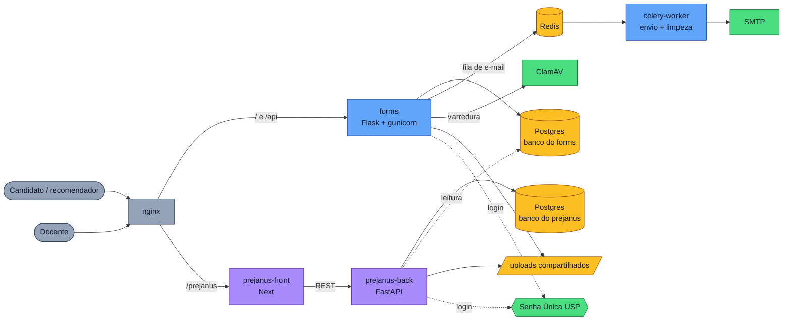
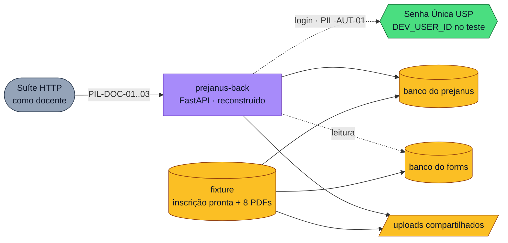

Um resumo de como o caronte-core se organiza, lido do commit congelado em `caronte-core/`.

<!-- truncate -->

O caronte-core é o sistema de inscrições em editais da pós-graduação do IME. O candidato
preenche o formulário e anexa documentos no `forms`, e os recomendadores recebem convite por
e-mail. Depois o docente avalia as inscrições no prejanus. Tudo sobe com um `docker compose`,
atrás de um nginx.

Azul é o `forms`, roxo o prejanus, amarelo é onde os dados ficam e verde são os serviços
externos.

- **forms**: formulários de candidatura, cartas de recomendação e anexos. Os e-mails passam
  por uma fila no Redis, e o `celery-worker` os envia e apaga, a cada hora, os uploads que
  ficaram sem uso.
- **prejanus**: lista e detalhe das inscrições, comentários, rótulos e notas privadas. O
  `prejanus-back` tem banco próprio e um usuário só de leitura no banco do `forms`. Essa
  leitura direta é o único acoplamento entre os dois sistemas, junto com a pasta de uploads.
- **Postgres**: um único contêiner com os dois bancos, criados por
  `docker/init.postgres.sh`.

## O que o piloto reconstrói

O piloto serve para ver se reconstruir o caronte com o harness escala. Ele reconstrói só a
consulta do `prejanus-back`: o docente encontra uma inscrição, lê as respostas e abre os
anexos. Se o resultado parecer razoável, o experimento passa para o sistema inteiro.

A fixture monta o estado inicial igual no original e nas reconstruções, já com a inscrição
criada. Ficam de fora o `forms`, o `prejanus-front`, Redis, smtp4dev, ClamAV e as rotas do
`prejanus-back` que mandam e-mail.
