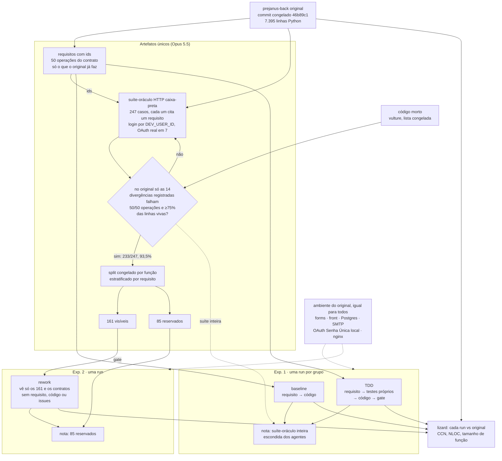

O experimento vai reconstruir só o PreJanus-back. Fechei esse escopo com o Paulo e o
Jorge em 21/10, depois dos pilotos. Aqui registro o desenho, os tetos de cada run e as
regras para invalidar uma run antes de rodar a primeira, como combinei no
[post do pivô](/blog/pivo-caronte).

<!-- truncate -->

## Por que só o PreJanus-back

No pivô, o plano era reconstruir o caronte-core inteiro, com cerca de 30 mil linhas entre
o forms, o prejanus-back e o prejanus-front. O piloto diria se isso cabia no prazo e no
crédito que tenho. Os pilotos mostraram que o PreJanus-back sozinho já tem requisito,
ambiente e suíte-oráculo prontos, e que ele já separa as entregas: no piloto v3, a
baseline passou em 139 dos 247 casos e o TDD em 185. Levar o forms e o front para o
experimento exigiria requisitos e oráculo de telas que ainda não existem, além de
validar o build do front gerado.

## O desenho

O que mudou em relação ao desenho de 14/10:

- **Alvo.** É o prejanus-back do commit congelado `46b89c1`, com 7.395 linhas Python e
  50 operações no contrato. O forms, o front, o Postgres, o SMTP local, o provedor OAuth
  local da Senha Única e o nginx vêm do original e formam o mesmo ambiente para todas as
  runs.
- **Suíte-oráculo.** Só HTTP, com 247 casos: 246 de comportamento e um que confere se
  todo requisito tem teste. O login entra pelo atalho `DEV_USER_ID`, e o fluxo OAuth real
  fica nos 7 casos que o avaliam ([post de 21/10](/blog/piloto-v3-oraculo-sem-porta-unica)).
- **Critério no original.** A suíte não passa em 100% do original. Ela passa em 233/247,
  e só falham as 14 divergências registradas, casos em que o original contraria o
  requisito. Elas ficam no denominador, porque uma reconstrução pode acertá-las. A
  cobertura é de 93,5% das linhas vivas (2.398 de 2.565), com as 50 operações
  exercitadas. As linhas mortas saem do vulture.
- **Split.** A unidade é a função de teste com todas as suas parametrizações,
  estratificada pelo requisito: 94 funções visíveis, com 161 casos, e 32 reservadas, com
  85. O split está congelado desde 17/10.
- **Executor.** Os agentes rodam no harness Agno, com leitura e escrita incremental de
  arquivos, e não no opencode. Continuam sem executar comandos: quem roda o gate é o
  harness.
- **Repetições.** Por enquanto, uma run por grupo. O experimento 1 é um estudo de caso, e
  a análise desce ao nível de requisito.

O CUA continua fora destes experimentos, como no pivô.

## As runs

Todas usam o GLM 5.3 pelo OpenRouter, só no provedor `novita/fp8` e sem fallback, com
`temperature` 0,1 e `top_p` 0,9. A entrada é a mesma do piloto v3,
`demos/requisitos/05-prejanus-back-piloto-v3/`, e o rework recebe a entrada derivada
dela, só com os testes visíveis e os contratos. O código de `demos/harness/` e
`demos/caronte/` fica congelado como está no commit `8d3c339` até as três runs
terminarem. As runs rodam uma de cada vez, porque trocam os mesmos backends do ambiente,
e o oráculo roda depois de cada geração.

| Run | Experimento | Etapas | Teto de cada etapa |
|---|---|---|---|
| baseline | 1 | código | US$ 2, 40 propostas, 3.600 s |
| TDD | 1 | testes e código | US$ 2, 40 propostas, 3.600 s |
| rework | 2 | código, com gate nos 161 visíveis | US$ 2, 40 propostas, 3.600 s |

Custo e tempo são conferidos antes de cada chamada ao modelo. A última chamada de uma
etapa pode passar do teto, e o `RUN.log` registra o valor real. O tempo do gate conta no
teto da etapa. Uma proposta é cada entrega do código ao gate; as chamadas de ferramenta
dentro da sessão não contam como proposta.

O gasto total fica limitado a US$ 12. No pior caso, as três runs gastam US$ 8, mais a
última chamada de cada etapa, que no piloto não passou de US$ 0,07. O que sobra cobre
repetir uma run invalidada, inclusive a do TDD. Pelo custo do piloto, espero gastar entre
US$ 3,50 e US$ 4,50.

## Quando uma run vale

Conta como resultado tudo o que depende do modelo: app que não sobe, teste que reprova,
teto de custo, tempo ou propostas atingido.

Uma falha do harness ou do ambiente invalida a run, e ela é repetida nas mesmas
condições. Entram aqui uma exceção no código do harness, o Docker ou o banco fora do ar
e um erro do provedor na chamada, inclusive não devolver o custo. A run invalidada fica
registrada, com o motivo, ao lado da que a substitui.

As runs dos pilotos ficam fora dos resultados. Como a entrada é a do piloto v3, as runs
formais também vão sair em pastas `05-prejanus-back-piloto-v3-*`; valem as que tiverem
data posterior a este post.

## A nota

No experimento 1, a nota é a aprovação na suíte-oráculo inteira, os 247 casos, que nenhum
agente vê. Também vou separar visíveis, reservados e os casos de cada requisito.

No experimento 2, a nota é a aprovação nos 85 casos reservados. Os 161 visíveis servem só
de gate.

Como medidas secundárias, cada etapa tem custo, tempo, tokens e propostas no `RUN.log`,
e o lizard compara cada run com o original em complexidade ciclomática, NLOC e tamanho
de função, sem as linhas mortas.
