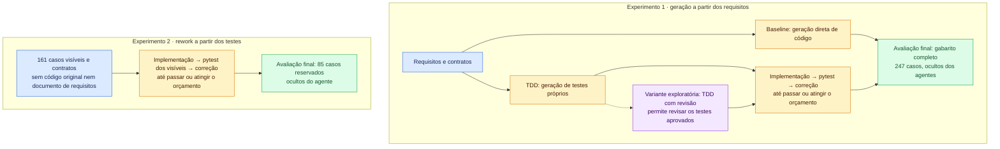

<table>
  <thead>
    <tr><th rowSpan={2}>Métrica</th><th colSpan={3}>Experimento 1</th><th>Experimento 2</th></tr>
    <tr><th>Baseline</th><th>TDD</th><th>TDD com revisão (exploratório)</th><th>Rework</th></tr>
  </thead>
  <tbody>
    <tr><th scope="row">Gabarito</th><td>186/247</td><td>140/247</td><td>194/247</td><td>211/247</td></tr>
    <tr><th scope="row">Acerto</th><td>75,3%</td><td>56,7%</td><td>78,5%</td><td>85,4%</td></tr>
    <tr><th scope="row">Visíveis</th><td>123/161</td><td>90/161</td><td>130/161</td><td>151/161</td></tr>
    <tr><th scope="row">Reservados</th><td>62/85</td><td>49/85</td><td>63/85</td><td>59/85</td></tr>
    <tr><th scope="row">Testes próprios no fim</th><td>—</td><td>27/56</td><td>81/83</td><td>151/161</td></tr>
    <tr><th scope="row">Propostas do coder</th><td>1</td><td>10</td><td>6</td><td>2</td></tr>
    <tr><th scope="row">Fim da etapa de código</th><td>entrega única</td><td>tempo</td><td>custo</td><td>custo</td></tr>
    <tr><th scope="row">Custo</th><td>US$ 0,56</td><td>US$ 2,07</td><td>US$ 2,22</td><td>US$ 2,03</td></tr>
    <tr><th scope="row">Tempo de geração</th><td>518 s</td><td>3.965 s</td><td>2.926 s</td><td>3.952 s</td></tr>
    <tr><th scope="row">Tokens</th><td>2.645.297</td><td>7.432.539</td><td>8.526.253</td><td>9.366.703</td></tr>
  </tbody>
</table>

<!-- truncate -->

## Análise estática

Coletei em 29/10 as métricas do código de produção com lizard 1.24.1 e
Radon 6.0.1:

Todas as métricas das duas tabelas consideram apenas código de produção:

- **TDD:** os testes gerados pelo test-writer ficam fora da contagem.
- **TDD com revisão:** os testes gerados pelo test-writer, inclusive os revisados durante a execução, ficam fora da contagem.
- **Rework:** os testes visíveis fornecidos como entrada ficam fora da contagem; as 2.110 linhas de NLOC correspondem apenas ao código de produção gerado.
- **Original e baseline:** também são medidos apenas os arquivos de produção.

Os testes do gabarito ficam fora das métricas em todas as condições.

### Lizard

| Entrega | Arquivos | NLOC | Funções | CC média | CC máxima | CC > 10 | NLOC/função média | NLOC/função máxima |
|---|---:|---:|---:|---:|---:|---:|---:|---:|
| Original bruto | 84 | 4847 | 157 | 3,81 | 84 | 8 | 20,54 | 243 |
| Original sem faixas mortas | 84 | 4723 | 153 | 3,81 | 84 | 8 | 20,42 | 243 |
| Baseline | 17 | 1730 | 126 | 3,46 | 22 | 6 | 11,58 | 52 |
| TDD | 17 | 2563 | 139 | 3,80 | 26 | 11 | 14,96 | 59 |
| Rework | 17 | 2110 | 146 | 3,06 | 19 | 6 | 11,40 | 55 |
| TDD com revisão (exploratório) | 17 | 2059 | 121 | 3,95 | 29 | 8 | 14,97 | 62 |

Legenda das colunas do [Lizard](https://github.com/terryyin/lizard):

- **Entrega:** versão do código analisada.
- **Arquivos:** quantidade de arquivos Python de produção analisados.
- **NLOC:** total de linhas de código, sem comentários nem linhas em branco, segundo a contagem do Lizard.
- **Funções:** quantidade de funções e métodos identificados.
- **CC média:** média da complexidade ciclomática das funções e métodos. Essa métrica conta caminhos independentes no fluxo do código: decisões como `if` e laços aumentam o valor. Valores maiores indicam mais caminhos para entender e testar.
- **CC máxima:** maior complexidade ciclomática encontrada em uma função ou método.
- **CC > 10:** quantidade de funções e métodos com complexidade ciclomática acima de 10; não é uma porcentagem nem uma contagem de defeitos.
- **NLOC/função média:** média de linhas de código por função ou método.
- **NLOC/função máxima:** quantidade de linhas de código da maior função ou método.

### Radon

| Entrega | SLOC | LLOC | CC média | CC máxima | CC > 10 | MI mediano | MI mínimo |
|---|---:|---:|---:|---:|---:|---:|---:|
| Original bruto | 4967 | 3217 | 3,83 | 84 | 8 | 64,75 | 12,29 |
| Original sem faixas mortas | 4843 | 3149 | 3,84 | 84 | 8 | 65,40 | 12,29 |
| Baseline | 1730 | 1511 | 3,46 | 22 | 6 | 53,07 | 17,08 |
| TDD | 2563 | 1788 | 3,80 | 26 | 11 | 45,99 | 9,42 |
| Rework | 2110 | 1501 | 3,27 | 19 | 7 | 43,33 | 13,20 |
| TDD com revisão (exploratório) | 2059 | 1495 | 3,95 | 29 | 8 | 45,03 | 10,89 |

Legenda das colunas do [Radon](https://radon.readthedocs.io/en/stable/intro.html):

- **Entrega:** versão do código analisada, a mesma da tabela anterior.
- **SLOC:** total de linhas físicas de código, sem linhas em branco e comentários, segundo as regras do Radon.
- **LLOC:** total de linhas lógicas de código, isto é, instruções em vez de linhas do arquivo. Uma instrução distribuída em várias linhas físicas pode contar como uma linha lógica.
- **CC média:** média da complexidade ciclomática das funções e métodos, com o mesmo significado da tabela do Lizard, mas segundo as regras do Radon.
- **CC máxima:** maior complexidade ciclomática encontrada em uma função ou método.
- **CC > 10:** quantidade de funções e métodos com complexidade ciclomática acima de 10.
- **MI mediano:** mediana do índice de manutenibilidade dos arquivos. O MI combina tamanho, complexidade, volume de Halstead (baseado em operadores e operandos) e proporção de comentários em uma escala de 0 a 100; valores maiores sugerem maior facilidade de manutenção. A mediana é o valor central da distribuição.
- **MI mínimo:** menor índice de manutenibilidade entre os arquivos analisados; destaca o arquivo com o menor resultado nessa métrica.

As médias de complexidade dão o mesmo peso a cada função ou método. O Radon
inclui funções internas e não soma classes como funções adicionais. O MI é
calculado por arquivo, com `multi=False`; a mediana e o mínimo ignoram arquivos
sem código. As contagens das duas ferramentas seguem regras próprias.

O rework tem a menor complexidade média entre as entregas; o TDD produziu mais
linhas e mais funções com complexidade acima de 10 que a baseline. Esses
números descrevem a estrutura: não compensam falhas no gabarito, nem mostram
que uma entrega menor implementa o mesmo comportamento. Há uma run por
condição, e a variante com revisão continua exploratória.

Guardei o [dados completos e as regras de seleção](https://github.com/educg550/tcc/tree/main/demos/analises/prejanus-back)
em `demos/analises/prejanus-back/`. O JSON permite localizar cada função e
conferir os hashes; o CSV preserva as métricas sem arredondamento. O coletor
está em `demos/caronte/analisar_estatica.py`.

## Análise estática dos testes

Medi separadamente os testes com Lizard 1.24.1. Nos dois TDDs, analisei os
testes ao fim da execução; na variante com revisão, isso inclui as alterações
aprovadas. No rework, são os testes visíveis fornecidos como entrada. O gabarito
completo (oráculo) inclui os casos visíveis, reservados e de rastreio.

| Suíte | Arquivos | NLOC | Funções | CC média | CC máxima | CC > 10 | NLOC/função média | NLOC/função máxima |
|---|---:|---:|---:|---:|---:|---:|---:|---:|
| TDD — testes gerados | 11 | 1095 | 100 | 2,74 | 16 | 1 | 10,30 | 48 |
| TDD com revisão — testes finais (exploratório) | 11 | 935 | 117 | 1,85 | 14 | 1 | 7,68 | 32 |
| Rework — testes visíveis fornecidos | 12 | 1062 | 137 | 2,04 | 11 | 2 | 5,91 | 49 |
| Gabarito completo (oráculo) | 13 | 1414 | 172 | 2,09 | 11 | 2 | 6,02 | 49 |

**Legenda:** Arquivos é a quantidade de arquivos Python analisados; NLOC é o
total de linhas de código, sem comentários nem linhas em branco; Funções conta
funções e métodos, incluindo testes, fixtures e auxiliares. CC média e CC máxima
são a média e o maior valor de complexidade ciclomática dessas funções; CC > 10
conta quantas ultrapassam 10. NLOC/função média e máxima indicam o tamanho médio
e o tamanho da maior função em linhas de código. As contagens de funções não
equivalem à quantidade de casos de teste, pois há parametrizações e auxiliares.

## Por área do gabarito

| Área | Casos | Original | Baseline | TDD | TDD com revisão | Rework |
|---|---:|---:|---:|---:|---:|---:|
| Acesso | 63 | 62 | 56 | 57 | 58 | 53 |
| Avaliação | 21 | 21 | 18 | 10 | 17 | 18 |
| Editais | 22 | 22 | 19 | 18 | 22 | 22 |
| Formulários | 24 | 24 | 7 | 15 | 11 | 24 |
| Inscrições | 29 | 25 | 14 | 8 | 21 | 22 |
| Mapeamentos | 27 | 27 | 26 | 3 | 20 | 26 |
| Mensagens | 16 | 11 | 13 | 7 | 12 | 13 |
| Percursos | 1 | 0 | 0 | 0 | 0 | 0 |
| Rastreio | 1 | 1 | 1 | 1 | 1 | 1 |
| Relatórios | 10 | 9 | 6 | 1 | 7 | 9 |
| Seleção | 33 | 31 | 26 | 20 | 25 | 23 |
| **Total** | **247** | **233** | **186** | **140** | **194** | **211** |

## Todas as runs

| Run | Grupo | Gabarito | Visíveis | Reservados | Custo | Fim da etapa de código | Situação |
|---|---|---:|---:|---:|---:|---|---|
| 18/10 16:59 | Baseline | app não sobe | — | — | US$ 0,06 | entrega única | Piloto v2, fixture antiga |
| 18/10 18:22 | TDD | 2/247 | 1/161 | 0/85 | US$ 0,70 | tempo, 9 propostas | Piloto v2, fixture antiga |
| 18/10 20:16 | Rework | 2/247 | 1/161 | 0/85 | US$ 0,27 | tempo, 2 propostas | Piloto v2, fixture antiga |
| 19/10 09:57 | Baseline | 139/247 | 89/161 | 49/85 | US$ 0,38 | entrega única | Piloto v3 |
| 19/10 10:38 | TDD | 185/247 | 123/161 | 61/85 | US$ 1,30 | custo, 4 propostas | Piloto v3 |
| 21/10 15:56 | Rework | 2/247 | 1/161 | 0/85 | US$ 0,78 | tempo, 1 proposta | Piloto v3 |
| 23/10 14:16 | Baseline | 191/247 | 131/161 | 59/85 | US$ 0,33 | entrega única | Substituída |
| 23/10 14:43 | TDD | 209/247 | 135/161 | 73/85 | US$ 0,94 | verde, 6 propostas | Invalidada |
| 23/10 18:23 | Rework | 190/247 | 127/161 | 62/85 | US$ 0,91 | tempo, 4 propostas | Invalidada |
| 23/10 19:53 | TDD | 206/247 | 142/161 | 63/85 | US$ 0,98 | verde, 3 propostas | Substituída |
| 23/10 20:32 | Rework | 209/247 | 154/161 | 54/85 | US$ 1,52 | tempo, 3 propostas | Substituída |
| 23/10 22:17 | Baseline | 186/247 | 123/161 | 62/85 | US$ 0,56 | entrega única | Vale |
| 23/10 22:39 | TDD | 140/247 | 90/161 | 49/85 | US$ 2,07 | tempo, 10 propostas | Vale |
| 24/10 00:04 | Rework | 211/247 | 151/161 | 59/85 | US$ 2,03 | custo, 2 propostas | Vale |
| 27/10 16:18 | TDD com revisão | 194/247 | 130/161 | 63/85 | US$ 2,22 | custo, 6 propostas | Exploratória |
