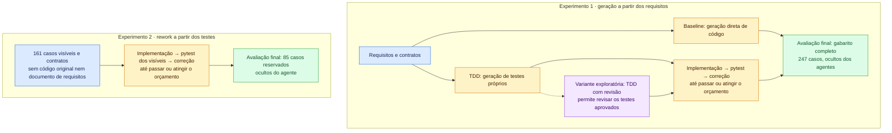

<table>
  <thead>
    <tr><th rowSpan={2}>Métrica</th><th colSpan={3}>Experimento 1</th><th>Experimento 2</th></tr>
    <tr><th>Baseline</th><th>TDD</th><th>TDD com revisão (exploratório)</th><th>Rework</th></tr>
  </thead>
  <tbody>
    <tr><th scope="row">Gabarito</th><td>186/247</td><td>140/247</td><td>194/247</td><td>211/247</td></tr>
    <tr><th scope="row">Acerto</th><td>75,3%</td><td>56,7%</td><td>78,5%</td><td>85,4%</td></tr>
    <tr><th scope="row">Visíveis</th><td>123/161</td><td>90/161</td><td>130/161</td><td>151/161</td></tr>
    <tr><th scope="row">Reservados</th><td>62/85</td><td>49/85</td><td>63/85</td><td>59/85</td></tr>
    <tr><th scope="row">Testes próprios no fim</th><td>—</td><td>27/56</td><td>81/83</td><td>151/161</td></tr>
    <tr><th scope="row">Propostas do coder</th><td>1</td><td>10</td><td>6</td><td>2</td></tr>
    <tr><th scope="row">Fim da etapa de código</th><td>entrega única</td><td>tempo</td><td>custo</td><td>custo</td></tr>
    <tr><th scope="row">Custo</th><td>US$ 0,56</td><td>US$ 2,07</td><td>US$ 2,22</td><td>US$ 2,03</td></tr>
    <tr><th scope="row">Tempo de geração</th><td>518 s</td><td>3.965 s</td><td>2.926 s</td><td>3.952 s</td></tr>
    <tr><th scope="row">Tokens</th><td>2.645.297</td><td>7.432.539</td><td>8.526.253</td><td>9.366.703</td></tr>
  </tbody>
</table>

<!-- truncate -->

## Por área do gabarito

| Área | Casos | Original | Baseline | TDD | TDD com revisão | Rework |
|---|---:|---:|---:|---:|---:|---:|
| Acesso | 63 | 62 | 56 | 57 | 58 | 53 |
| Avaliação | 21 | 21 | 18 | 10 | 17 | 18 |
| Editais | 22 | 22 | 19 | 18 | 22 | 22 |
| Formulários | 24 | 24 | 7 | 15 | 11 | 24 |
| Inscrições | 29 | 25 | 14 | 8 | 21 | 22 |
| Mapeamentos | 27 | 27 | 26 | 3 | 20 | 26 |
| Mensagens | 16 | 11 | 13 | 7 | 12 | 13 |
| Percursos | 1 | 0 | 0 | 0 | 0 | 0 |
| Rastreio | 1 | 1 | 1 | 1 | 1 | 1 |
| Relatórios | 10 | 9 | 6 | 1 | 7 | 9 |
| Seleção | 33 | 31 | 26 | 20 | 25 | 23 |
| **Total** | **247** | **233** | **186** | **140** | **194** | **211** |

## Todas as runs

| Run | Grupo | Gabarito | Visíveis | Reservados | Custo | Fim da etapa de código | Situação |
|---|---|---:|---:|---:|---:|---|---|
| 18/10 16:59 | Baseline | app não sobe | — | — | US$ 0,06 | entrega única | Piloto v2, fixture antiga |
| 18/10 18:22 | TDD | 2/247 | 1/161 | 0/85 | US$ 0,70 | tempo, 9 propostas | Piloto v2, fixture antiga |
| 18/10 20:16 | Rework | 2/247 | 1/161 | 0/85 | US$ 0,27 | tempo, 2 propostas | Piloto v2, fixture antiga |
| 19/10 09:57 | Baseline | 139/247 | 89/161 | 49/85 | US$ 0,38 | entrega única | Piloto v3 |
| 19/10 10:38 | TDD | 185/247 | 123/161 | 61/85 | US$ 1,30 | custo, 4 propostas | Piloto v3 |
| 21/10 15:56 | Rework | 2/247 | 1/161 | 0/85 | US$ 0,78 | tempo, 1 proposta | Piloto v3 |
| 23/10 14:16 | Baseline | 191/247 | 131/161 | 59/85 | US$ 0,33 | entrega única | Substituída |
| 23/10 14:43 | TDD | 209/247 | 135/161 | 73/85 | US$ 0,94 | verde, 6 propostas | Invalidada |
| 23/10 18:23 | Rework | 190/247 | 127/161 | 62/85 | US$ 0,91 | tempo, 4 propostas | Invalidada |
| 23/10 19:53 | TDD | 206/247 | 142/161 | 63/85 | US$ 0,98 | verde, 3 propostas | Substituída |
| 23/10 20:32 | Rework | 209/247 | 154/161 | 54/85 | US$ 1,52 | tempo, 3 propostas | Substituída |
| 23/10 22:17 | Baseline | 186/247 | 123/161 | 62/85 | US$ 0,56 | entrega única | Vale |
| 23/10 22:39 | TDD | 140/247 | 90/161 | 49/85 | US$ 2,07 | tempo, 10 propostas | Vale |
| 24/10 00:04 | Rework | 211/247 | 151/161 | 59/85 | US$ 2,03 | custo, 2 propostas | Vale |
| 27/10 16:18 | TDD com revisão | 194/247 | 130/161 | 63/85 | US$ 2,22 | custo, 6 propostas | Exploratória |
