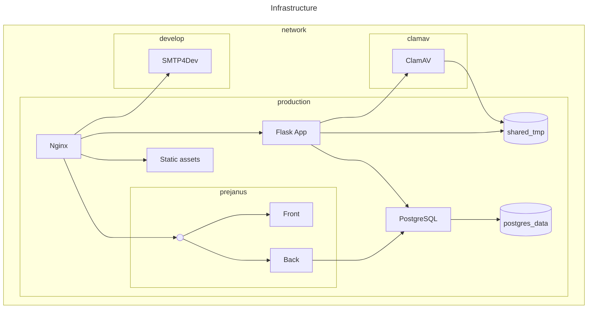

## History

This repository is composed of multiple others that were joined in this monorepo using [git subtree](https://git-scm.com/book/en/v2/Git-Tools-Advanced-Merging.html#_subtree_merge). Find the original repos at:

* [infra](https://gitlab.com/ccsl-usp/poscomp-ime/caronte/infra)
* [forms](https://gitlab.com/ccsl-usp/poscomp-ime/caronte/forms)
* [prejanus-back](https://gitlab.com/ccsl-usp/poscomp-ime/caronte/prejanus-back)
* [prejanus-front](https://gitlab.com/ccsl-usp/poscomp-ime/caronte/prejanus-front)
* [static-assets](https://gitlab.com/ccsl-usp/poscomp-ime/caronte/static-assets)
* [gitlab-profile](https://gitlab.com/ccsl-usp/poscomp-ime/caronte/gitlab-profile)

All previous commits are preserved, but joining all the trees resulted in a merge commit for each one which may lead to confusing history.

If you find yourself looking for history but hitting one of those merge commits, check below a command example that should help:

```
git blame -C -C ./forms/README.md
```

### Pulling changes

If you want to pull something from of the old repositories:

```
git subtree pull --prefix=forms git@gitlab.com:ccsl-usp/poscomp-ime/caronte/forms.git main
```

## Development env

Check the [HACKING](./HACKING.md) file.
