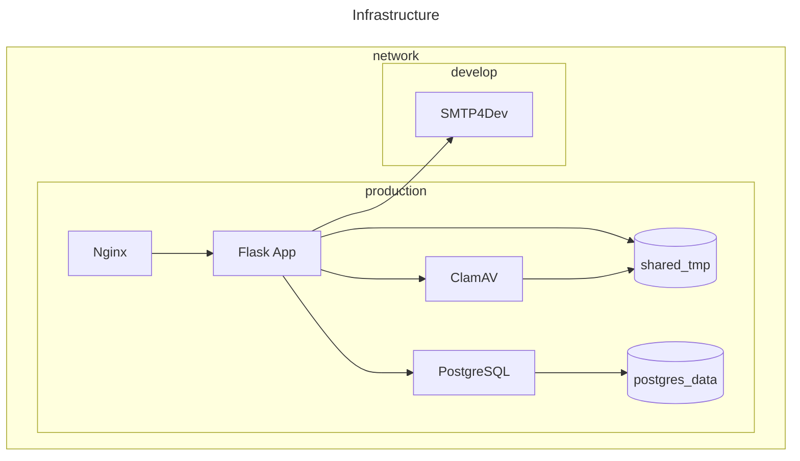

Este projeto é um sistema de formulários web dinâmicos com suporte a múltiplas seções e campos.

Cada formulário pode ser acessado publicamente através de um **token de compartilhamento** com data de expiração, que permite gerar posteriormente um **token de resposta**.

O sistema salva o progresso do usuário, possibilitando que ele retorne para continuar o preenchimento a partir da seção onde parou, utilizando um token persistente vinculado à resposta.

Para garantir a segurança no envio de arquivos, o sistema integra um servidor **ClamAV** via conexão TCP. Apenas arquivos permitidos (validados por tipo MIME e tamanho máximo) e considerados seguros são aceitos.

Suporte à internacionalização (i18n): os formulários e seus campos podem ser apresentados de acordo com o idioma selecionado pelo usuário.



## Comandos

Os e-mails de usuários com cargos administrativos devem estar listados no arquivo `admin_emails.txt`, separados por vírgula.

Pode listar os comandos disponíveis executando o seguinte comando via container Docker:

```sh
docker exec -it <CONTAINER_WEB_ID> flask commands
```

## Traduções

Para extrair e mapear as `strings` (definidas com `gettext()` ou `_()`) e armazenar o modelo. Mesclando com as traduções ja realizadas em [`translations/`](./translations/)

```sh
pybabel extract -F babel.cfg -o messages.pot .
pybabel update -i messages.pot -d translations
```

Para compilar as traduções para uso

```sh
pybabel compile -d translations
```

## Testes

Dentro do container, execute:

```sh
pytest --login=<NUSP> --password=<PASSWORD>
```

## Deploy

Para mais detalhes, consulte a documentação:


## Licença

Este projeto utiliza arquivos licenciados. Consulte a página [`GITLAB SVGS`](https://gitlab.com/gitlab-org/gitlab-svgs/) para obter mais detalhes.