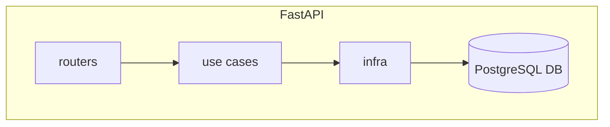

# Introduction

PreJanus is responsible for the management and follow-through of the subscriptions for students at Masters and Doctorate degrees 
in Computer Science at Universidade de São Paulo.

This repository contains a web application that provides a REST API to manage this process.



---

# Getting Started

## Prerequisites

It is recommended to have `docker` and `docker-compose` installed to ease application startup. For development, it is required to have `python 3.11`.

#### Local development

In order to perform a local installation, for PostgreSQL dependencies you need some prerequisites:
- a C compiler,
- Python development headers (e.g. the python3-dev package).
- PostgreSQL client development headers (e.g. the libpq-dev package).
- The pg_config program available in the PATH.

> **NOTE**: The local installation for psycopg is not supported by PyPy.

## Startup

The project can be initialized by using `docker-compose`. To start up the application container and all required dependencies (e.g. database) we can simply execute:

 User Registration and Authentication
This project uses Senhaunica USP to manage user registration and authentication. Below are the detailed steps to set up the environment and access the registration and authentication features.


Register a User
New users can register using the /users endpoint.
    • HTTP Method: POST 
    • Request Structure: 
      {
        "email": "example@domain.com",
        "password": "securePassword",
        "name": "Full Name"
      }
    • Refer to the API documentation for more information about required fields and expected responses. 

 Authenticate a User
Registered users can authenticate using the /auth/login endpoint.
    • HTTP Method: POST 
    • Request Structure: 
      {
        "email": "example@domain.com",
        "password": "securePassword"
      }
      Check the API documentation for details about the authentication tokens generated and the renewal process. 


```sh
docker-compose up
```

The application will be available at `http://localhost:8000` with Swagger UI at `http://localhost:8000/docs`, which provides a documented as well as interactive way to access the application.

## Development

### Dependencies

The dependencies are managed using [poetry](https://python-poetry.org). To install it:

```sh
curl -sSL https://install.python-poetry.org | python3 -
```

> **NOTE**: It is recommended to move to version >=1.2 as there might be breaking changes with the new [dependency groups](https://python-poetry.org/blog/announcing-poetry-1.2.0/#dependency-groups) feature.

> **NOTE**: It is not recommended to install poetry within the virtual environment as its own packages can interfere with the project's dependencies. For more information on installing poetry, see [here](https://python-poetry.org/docs/#installation).


Install the dependencies:

```sh
poetry install
```

Poetry will keep the virtual environment up to date when new dependencies are added (`poetry add <package>` or `poetry add --source <source_name> <package>` for explicit external sources) or removed (`poetry remove <package>`). It also separates production dependencies from development dependencies as show in the `pyproject.toml`(to add or remove development dependencies, use the flag `--group dev`). More information on use poetry can be found [here](https://www.notion.so/shapedigital/Poetry-Guide-b8925ea8bc08481091883282d792cbf0).


#### PostgreSQL and psycopg

This project uses PostgreSQL as the database and psycopg as the Python adapter for PostgreSQL.

##### Local installation

To install psycopg, you can follow the official documentation [here](https://www.psycopg.org/psycopg3/docs/basic/install.html#local-installation).

### Alembic and Database Migrations

This project is configured to use [Alembic](https://alembic.sqlalchemy.org/en/latest/). Alembic is a database migration tool for usage with the SQLAlchemy.

#### Generating Migrations

To generate a migration, use the revision command in conjunction with the `--autogenerate` option:

```
alembic revision --autogenerate -m "Create/change/drop something"
```

> **NOTE**: The --autogenerate option tells Alembic to compare the current state of your models with the state of your database and automatically generate a migration script that represents the changes needed to align the two. This can include operations like creating new tables (if new models have been added), adding or removing columns (if model fields have been added or removed), or changing column types (if model field types have been changed). Please note that --autogenerate is not perfect and does not replace the need for manual review of migration scripts.

#### Applying Migrations

To manually apply all pending migrations to your database, use the upgrade command:

```
alembic upgrade head
```


### Build and Test

The project is configured to use [pytest](https://docs.pytest.org/en/7.1.x/) as the test runner.
To run all the tests:

```sh
pytest
```

### Gotchas

The necessary environment variables should be all listed in the `.env.example`. In your local environment, create a `.env` file with the same variables listed in the  example, and configure your app accordingly to your necessities.

If you added a new python lib in your project via poetry and is using the docker container for local development, you should remove the existent containers and rebuild the app image, so the dependencies are also added to the container. This can be done with the following commands:

```sh
docker compose down  # Stop and remove all containers, networks, etc.
docker compose build prejanus --no-cache  # Force rebuild without using cache
docker compose up  # Start the containers again
```
