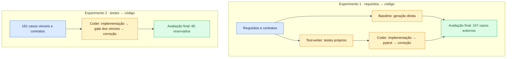

# Metodologia

O estudo tem duas partes: o experimento em batch do formulário de solicitação
de auxílio financeiro do IME-USP (ProEx) e os experimentos de reconstrução do
PreJanus-back. As duas partes comparam geração direta e geração orientada por
testes, mas usam tarefas, modelos e instrumentos de avaliação diferentes.
Seus resultados são analisados separadamente.

## Parte 1 — Formulário de auxílio financeiro em batch

### Escopo e grupos

O alvo é uma aplicação web com duas abas, ALUNOS e DOCENTES, para solicitar
auxílio financeiro e gerar um ofício com os dados preenchidos. O requisito
fixa os campos, rótulos, validações, máscaras e conteúdo do ofício. O frontend
é HTML, CSS e JavaScript; o backend é Python com FastAPI, sem persistência.
O experimento implementa esse requisito fechado, sem reproduzir o processo
administrativo completo de aprovação do auxílio.

O lote reúne **200 runs**: 50 por combinação de modelo e grupo. Os modelos
são DeepSeek V4.1 Flash e GLM-5.3, com o mesmo modelo nas etapas de cada run.
As duas configurações recebem requisitos idênticos; mudam o modelo e seu teto
de custo. Os artefatos ficam em `demos/runs/batch/<modelo>/run<N>/<grupo>/`.

| Grupo | Geração | Feedback durante a geração |
|---|---|---|
| Baseline | requisito → código | nenhum resultado de testes |
| TDD | requisito → testes próprios → implementação | pytest dos testes gerados, seguido de correções até passar ou atingir o teto |

O harness usa Agno via OpenRouter. As runs começam em workspaces separados,
sem gate humano nem feedback textual do pesquisador. O batch executa até 25
runs simultaneamente. A geração termina antes da avaliação externa: Cypress,
CUA e avaliação humana não alimentam o laço de implementação.

Cada etapa tem limite de 50 propostas e 1.800 segundos. O teto de custo por
etapa é US$ 2 para DeepSeek e US$ 3 para GLM. O TDD tem etapas distintas de
testes e código; portanto, o mesmo teto por etapa não implica o mesmo
orçamento total entre os grupos. Custo, duração, tokens e encerramento são
registrados no `RUN.log`.

### Avaliação funcional e análise estática

Os testes gerados pelo TDD fazem parte do tratamento. A avaliação externa usa
uma suíte canônica de Cypress, comum às implementações, com seletores baseados
nos textos visíveis fixados pelo requisito. Isso evita comparar aplicações
com suítes feitas sob medida para o código de cada uma. A suíte foi conferida
contra uma execução com resultado conhecido antes da avaliação do lote.

Primeiro foram avaliados doze critérios funcionais. Para investigar o empate
entre as aplicações aprovadas, foram acrescentados dez critérios derivados
do mesmo requisito, como máscaras, mensagens de validação, preservação do
preenchimento e conteúdo do ofício. Esses critérios extras são uma análise
posterior ao primeiro resultado, não um protocolo definido antes da geração.

O Radon registra tamanho e complexidade do Python de implementação e dos
testes. Uma tentativa inicial de selecionar as melhores aplicações por índice
de manutenibilidade favoreceu esqueletos e implementações incompletas. Por
isso, as métricas estáticas ficaram como descrição estrutural, sem substituir
a avaliação funcional nem fornecer uma nota de qualidade da interface.

### Seleção e avaliação das interfaces

Na triagem registrada no diário, 153 runs tinham aplicação elegível para a
avaliação; 94 passaram nos doze critérios e 81 também nos dez extras. Entre
as empatadas, foi feito um torneio cego de preferência visual, com as
aplicações anônimas, lado sorteado e repescagem. Como as duas finalistas do
torneio geral eram baseline, um segundo torneio, restrito às 39 TDD aprovadas
nos dois conjuntos de critérios, selecionou duas finalistas desse grupo.

As quatro finalistas foram avaliadas por CUA e pelo pesquisador segundo as
dez heurísticas de Nielsen, com um percurso comum pelas duas abas, incluindo
preenchimento por teclado, erros de validação, envio e leitura do ofício.
Cada heurística recebe uma nota ordinal de Péssimo a Excelente, acompanhada
de justificativa e evidência. As notas do CUA e do pesquisador são mantidas
separadas. As sessões de CUA registradas nessa etapa usam browser-use 0.13.10
e Claude Opus 5.5 via OpenRouter; falhas de cumprimento do percurso e
inconsistências entre sessões são documentadas.

Essa avaliação das finalistas é seletiva: não estima a usabilidade das 200
runs. O torneio registra preferência do pesquisador e a comparação entre
campeãs de modelos diferentes não isola o efeito de TDD.

### Contagem de falhas e limites

O denominador das taxas de sucesso por modelo e grupo é o número de
tentativas da célula, **50**, e não apenas as runs elegíveis. Falhar no gate,
esgotar orçamento ou não produzir aplicação executável conta como reprovação.
O campo `etapas_ok` não é uma régua comum: a baseline não precisa passar no
pytest, enquanto o TDD pode ser reprovado por seus próprios testes. Os números
de elegibilidade descrevem a triagem, sem retirar falhas do denominador.

O estudo foi encerrado como inconclusivo para a pergunta de pesquisa: houve
muitas implementações funcionalmente empatadas, a preferência visual não
forneceu um desempate objetivo e as avaliações do CUA variaram entre sessões
da mesma aplicação. Isso motivou a passagem para um backend com mais
operações e avaliação HTTP externa. O experimento do formulário permanece
como a primeira parte do estudo, com seus resultados e limitações.

O protocolo e sua evolução estão no [relato do batch](/blog/harness-baseline-tdd),
na [seleção das finalistas](/blog/finalistas-nielsen), no
[torneio TDD](/blog/finalistas-nielsen-tdd), na
[comparação Nielsen](/blog/nielsen-baseline-vs-tdd) e nas
[observações sobre o CUA](/blog/observacoes-cua). A decisão de mudança de
cenário está no [pivô para o Caronte](/blog/pivo-caronte).

## Parte 2 — Reconstrução do PreJanus-back

### Escopo

Nesta parte, o estudo reconstrói as 50 operações HTTP do PreJanus-back, backend FastAPI
do Caronte, a partir do original no commit `46b89c1`. Frontend, forms,
bancos e serviços externos permanecem fixos. A avaliação é HTTP, caixa-preta;
o CUA previsto na [proposta](/docs/proposta) fica fora deste recorte.

### Experimentos

| Experimento | Condição | Entrada | Gate durante a geração | Avaliação final |
|---|---|---|---|---|
| 1 | Baseline | requisitos e contratos | nenhum | 247 casos externos |
| 1 | TDD | requisitos e contratos | pytest dos testes próprios | mesmos 247 casos |
| 2 | Rework | 161 testes visíveis e contratos | pytest dos visíveis | 85 casos reservados |

Cada run começa em um workspace vazio. A baseline gera código em uma sessão,
que pode envolver várias chamadas ao modelo. No TDD, um agente escreve os
testes e outro implementa e corrige o código até passar ou atingir o teto.
Os testes aprovados ficam congelados para o coder; sintaxe e nomes indefinidos
são checados, mas erros de significado podem bloquear a implementação.

O rework recebe apenas testes visíveis e contratos, sem código original,
documento de requisitos ou issues. Seu gate usa a cópia dos testes mantida
pelo avaliador. Nenhum agente acessa os casos reservados; no experimento 1,
o gabarito inteiro fica oculto.

### Gabarito

Requisitos e gabarito foram preparados uma vez, com apoio do Claude Opus 5.5,
fora das runs avaliadas. A suíte pytest/httpx contém 246 casos comportamentais
e um de rastreio. No original, passam 233/247; as 14 divergências registradas
permanecem no denominador. A validação exercitou as 50 operações e cobriu
93,5% das linhas vivas.

O split, estratificado por requisito, mantém as parametrizações de cada função
juntas: 161 casos visíveis e 85 reservados. O teste de rastreio fica fora dessa
divisão. Sete casos avaliam OAuth; os demais usam o login por `DEV_USER_ID`.

### Condições de execução

As runs usam Agno 2.6.16 e `z-ai/glm-5.3` via OpenRouter, no provedor
`novita/fp8`, sem fallback, com `temperature=0.1` e `top_p=0.9`. Contratos,
runtime e skills de implementação são compartilhados. Os agentes leem e
editam arquivos com histórico por etapa; o harness valida sintaxe e escopo,
grava as mudanças e executa os comandos.

A execução é batch, sem feedback humano, uma run de cada vez. As três runs
principais usam a configuração congelada em `7734bea`.

Cada etapa tem teto de **US$ 2, 40 propostas e 3.600 s**. Baseline e rework
têm uma etapa; TDD tem duas, testes e código. Custo e tempo são conferidos
antes de cada chamada, que pode ultrapassar o teto ao terminar. O tempo do
gate entra no orçamento. Propostas e chamadas ao modelo são contadas
separadamente. O limite solicitado de raciocínio é de 32 mil tokens, embora
o provedor tenha retornado respostas maiores.

### Registro e análise

A entrega e seus hashes são preservados antes da avaliação externa. O
`RUN.log` registra custo, duração, tokens, propostas, retries e motivo de
encerramento por etapa. Geração e avaliação têm consumo registrado
separadamente. O Radon mede tamanho, complexidade e índice de manutenibilidade
do código de produção e, separadamente, das suítes de testes. A comparação
com o original preserva as exclusões congeladas de código morto.

App que não sobe, teste reprovado e teto atingido contam como resultado.
Falhas do harness, da infraestrutura ou do provedor invalidam a run, que fica
registrada com o motivo e sua substituta. Todos os casos da régua permanecem
no denominador, inclusive erros de preparação.

Há **uma run válida por condição**; a análise é descritiva. Os casos do
gabarito compartilham a mesma entrega e não são repetições independentes.
O TDD com revisão é exploratório: permite revisar testes aprovados, mas usa
uma suíte recém-gerada e não isola o efeito dessa permissão. Os resultados
comparam os pipelines nessas condições, sem sustentar superioridade geral
do TDD. Repetições adicionais ainda não estão definidas.

Resultados e detalhes de execução estão no [resumo do diário](/blog/resumo-prejanus-back),
nas [runs refeitas](/blog/runs-refeitas-harness) e na
[variante com revisão](/blog/tdd-revisao-primeira-run).
