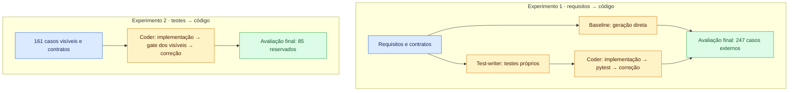

# Metodologia

## Escopo

O estudo reconstrói as 50 operações HTTP do PreJanus-back, backend FastAPI
do Caronte, a partir do original no commit `46b89c1`. Frontend, forms,
bancos e serviços externos permanecem fixos. A avaliação é HTTP, caixa-preta;
o CUA previsto na [proposta](/docs/proposta) fica fora deste recorte.

## Experimentos

| Experimento | Condição | Entrada | Gate durante a geração | Avaliação final |
|---|---|---|---|---|
| 1 | Baseline | requisitos e contratos | nenhum | 247 casos externos |
| 1 | TDD | requisitos e contratos | pytest dos testes próprios | mesmos 247 casos |
| 2 | Rework | 161 testes visíveis e contratos | pytest dos visíveis | 85 casos reservados |

Cada run começa em um workspace vazio. A baseline gera código em uma sessão,
que pode envolver várias chamadas ao modelo. No TDD, um agente escreve os
testes e outro implementa e corrige o código até passar ou atingir o teto.
Os testes aprovados ficam congelados para o coder; sintaxe e nomes indefinidos
são checados, mas erros de significado podem bloquear a implementação.

O rework recebe apenas testes visíveis e contratos, sem código original,
documento de requisitos ou issues. Seu gate usa a cópia dos testes mantida
pelo avaliador. Nenhum agente acessa os casos reservados; no experimento 1,
o gabarito inteiro fica oculto.

## Gabarito

Requisitos e gabarito foram preparados uma vez, com apoio do Claude Opus 5.5,
fora das runs avaliadas. A suíte pytest/httpx contém 246 casos comportamentais
e um de rastreio. No original, passam 233/247; as 14 divergências registradas
permanecem no denominador. A validação exercitou as 50 operações e cobriu
93,5% das linhas vivas.

O split, estratificado por requisito, mantém as parametrizações de cada função
juntas: 161 casos visíveis e 85 reservados. O teste de rastreio fica fora dessa
divisão. Sete casos avaliam OAuth; os demais usam o login por `DEV_USER_ID`.

## Condições de execução

As runs usam Agno 2.6.16 e `z-ai/glm-5.3` via OpenRouter, no provedor
`novita/fp8`, sem fallback, com `temperature=0.1` e `top_p=0.9`. Contratos,
runtime e skills de implementação são compartilhados. Os agentes leem e
editam arquivos com histórico por etapa; o harness valida sintaxe e escopo,
grava as mudanças e executa os comandos.

A execução é batch, sem feedback humano, uma run de cada vez. As três runs
principais usam a configuração congelada em `7734bea`.

Cada etapa tem teto de **US$ 2, 40 propostas e 3.600 s**. Baseline e rework
têm uma etapa; TDD tem duas, testes e código. Custo e tempo são conferidos
antes de cada chamada, que pode ultrapassar o teto ao terminar. O tempo do
gate entra no orçamento. Propostas e chamadas ao modelo são contadas
separadamente. O limite solicitado de raciocínio é de 32 mil tokens, embora
o provedor tenha retornado respostas maiores.

## Registro e análise

A entrega e seus hashes são preservados antes da avaliação externa. O
`RUN.log` registra custo, duração, tokens, propostas, retries e motivo de
encerramento por etapa. Geração e avaliação têm consumo registrado
separadamente. Lizard e Radon medem tamanho e complexidade do código de
produção, com as exclusões congeladas de código morto no original.

App que não sobe, teste reprovado e teto atingido contam como resultado.
Falhas do harness, da infraestrutura ou do provedor invalidam a run, que fica
registrada com o motivo e sua substituta. Todos os casos da régua permanecem
no denominador, inclusive erros de preparação.

Há **uma run válida por condição**; a análise é descritiva. Os casos do
gabarito compartilham a mesma entrega e não são repetições independentes.
O TDD com revisão é exploratório: permite revisar testes aprovados, mas usa
uma suíte recém-gerada e não isola o efeito dessa permissão. Os resultados
comparam os pipelines nessas condições, sem sustentar superioridade geral
do TDD. Repetições adicionais ainda não estão definidas.

Resultados e detalhes de execução estão no [resumo do diário](/blog/resumo-prejanus-back),
nas [runs refeitas](/blog/runs-refeitas-harness) e na
[variante com revisão](/blog/tdd-revisao-primeira-run).
